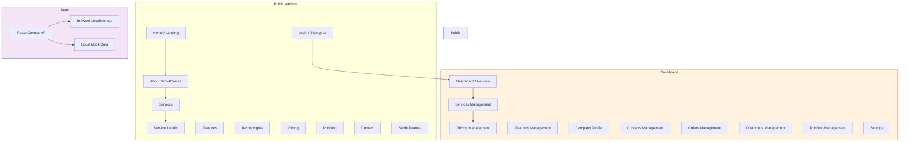
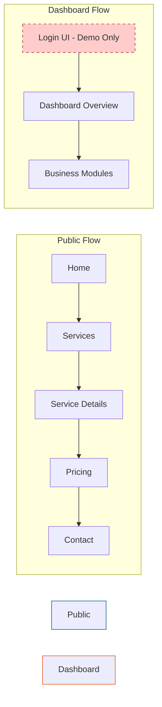

# GrowthVerse

**Build Digital. Grow Business.**

GrowthVerse is a digital technology company website and frontend business dashboard project. It is intended to present company information, services, features, pricing, technology capabilities, portfolio, and contact options through a public website, while providing frontend interfaces for managing business information, customers, orders, enquiries, and company profiles through a company dashboard.

**Project Version:** 1.0.0  
**Copyright:** © 2026 GrowthVerse  
**License:** MIT License  
**Project Status:** Frontend Not Started — Documentation and Planning Phase  
**Repository:** https://github.com/Aashu31/Growthverse

[](https://reactjs.org/)
[](https://developer.mozilla.org/en-US/docs/Web/JavaScript)
[](https://tailwindcss.com/)
[](LICENSE)
[](https://github.com/Aashu31/Growthverse)

---

## 2. Introduction

GrowthVerse is being developed as a modern digital technology and solutions company presence. The project has two primary components:

1. **Public Company Website** — a marketing-facing site that introduces GrowthVerse, explains its identity, and presents its services, features, technologies, pricing, portfolio, and contact options to visitors.
2. **Company Dashboard** — a frontend workspace for viewing and managing business information, including services, pricing, features, company profile, contacts, orders, customers, portfolio, and settings.

The public website and the company dashboard are part of the same frontend codebase. GrowthVerse is the primary company brand and platform. This is a frontend-only project. There is no backend server, no database, no secure production authentication, and no payment processing in the current scope.

This README documents the project as it actually exists in the repository. Where functionality is planned but not yet implemented, it is explicitly marked as planned or not started. No feature is described as complete unless implementation evidence exists in the source code.

---

## 3. Company Overview

### Company Identity

GrowthVerse is a digital technology and solutions company. The brand positioning is:

**"Build Digital. Grow Business."**

GrowthVerse focuses on helping businesses, startups, entrepreneurs, and organizations establish, improve, and expand their digital presence through technology and digital solutions.

### Business Positioning

GrowthVerse positions itself as a provider of digital technology solutions. The public website communicates the company's value proposition to visitors, while the dashboard offers frontend tooling for internal business operations.

### Vision

To help businesses build, improve, and scale their digital presence through modern, responsive, and accessible frontend technology solutions.

### Mission

GrowthVerse is committed to delivering digital experiences that support business growth — from public-facing marketing websites that attract customers to frontend dashboards that streamline business operations — using clean code, responsive design, and a maintainable component-based architecture.

### Objectives

- Establish a professional digital presence for GrowthVerse.
- Present company services, features, technologies, pricing, and portfolio to the public.
- Provide frontend interfaces for managing business information, customers, orders, enquiries, and company profiles.
- Deliver a modern, responsive, animated user experience using React and Tailwind CSS.

### Target Audience

- Businesses seeking a digital technology partner
- Visitors exploring company services, pricing, and portfolio
- Internal users managing dashboard operations (services, orders, customers, contacts)

### Core Values

- Clean, maintainable code
- Responsive and accessible design
- Transparent documentation of project status
- Frontend-only scope clarity (no false backend claims)

### Business Offerings

- Company branding and informational website
- Service and feature catalog presentation
- Pricing presentation
- Portfolio showcase
- Contact and enquiry handling
- Frontend dashboard for business operations management

---

## 4. Project Scope

### Public Company Website

The public website will explain the company, its identity, services, pricing, features, technology capabilities, and portfolio. Planned pages include:

- Home / Landing Page
- About GrowthVerse
- Services
- Individual Service Details
- Features
- Technologies
- Pricing
- Portfolio
- Contact
- Sarthi (feature presentation only)
- Login / Signup UI (frontend demonstration only)

### Company Dashboard

The dashboard will provide frontend interfaces for viewing and managing business information. Planned modules include:

1. Dashboard Overview
2. Services Management
3. Pricing Management
4. Features Management
5. Company Profile
6. Contacts Management
7. Orders Management
8. Customers Management
9. Portfolio Management
10. Settings

### Authentication UI

Login and signup interfaces are planned as frontend demonstrations only. No real authentication backend, secure access control, or user session management is included in the current scope.

### Sarthi Feature Presentation

Sarthi is a School Management Solution presented as a service/feature under GrowthVerse.

- Sarthi is **not** a separate company.
- Sarthi is **not** a separate repository.
- Sarthi's school management software is **not** being developed in this project.
- Sarthi backend functionality (student, attendance, fee, examination, or academic management systems) is **not** claimed to be developed.
- Only Sarthi's feature presentation and service information are documented within GrowthVerse.

### Frontend-Only Limitation

GrowthVerse is a frontend-only project. There is no backend, no database, no secure authentication, no payment processing, and no real email delivery. All data handling is local to the browser.

---

## 5. Complete Feature Catalogue

### Public Website

| Feature | Purpose | Current Status | Notes |
|---------|---------|----------------|-------|
| Home / Landing Page | Entry point presenting company overview and key highlights | PLANNED | No source code exists yet |
| About GrowthVerse | Company background, mission, and values | PLANNED | No source code exists yet |
| Services | Catalog of services offered by GrowthVerse | PLANNED | No source code exists yet |
| Individual Service Details | Dedicated page for each service | PLANNED | No source code exists yet |
| Features | Capabilities and feature highlights | PLANNED | No source code exists yet |
| Technologies | Technology stack and technical capabilities | PLANNED | No source code exists yet |
| Pricing | Service pricing plans and tiers | PLANNED | No source code exists yet |
| Portfolio | Showcase of past work and case studies | PLANNED | No source code exists yet |
| Contact | Contact form and enquiry options | PLANNED | No source code exists yet |
| Sarthi Feature Page | Marketing presentation of Sarthi, a School Management Solution | PLANNED | Feature presentation only; no backend |
| Login / Signup UI | Authentication interface | PLANNED | Frontend demo only; no real auth |

### Business Dashboard

| Module | Purpose | Current Status | Notes |
|--------|---------|----------------|-------|
| Dashboard Overview | High-level summary and statistics | PLANNED | Frontend demonstration only |
| Services Management | Manage service listings | PLANNED | Frontend demonstration only |
| Pricing Management | Manage pricing plans and tiers | PLANNED | Frontend demonstration only |
| Features Management | Manage feature listings | PLANNED | Frontend demonstration only |
| Company Profile | Edit company information | PLANNED | Frontend demonstration only |
| Contacts Management | Handle contacts and enquiries | PLANNED | Frontend demonstration only |
| Orders Management | Track and manage orders | PLANNED | Frontend demonstration only |
| Customers Management | Manage customer records | PLANNED | Frontend demonstration only |
| Portfolio Management | Manage portfolio items | PLANNED | Frontend demonstration only |
| Settings | Application configuration | PLANNED | Frontend demonstration only |

---

## 6. Dashboard Module Explanations

### Dashboard Overview

**Purpose:** High-level summary view displaying key business metrics and statistics.

**Intended Information:** Overview cards, summary statistics, recent activity, and charts.

**Expected User Interactions:** View summary data, navigate to detailed modules, refresh view.

**Intended Business Purpose:** Give dashboard users a quick snapshot of business operations.

**Current Implementation Status:** PLANNED. No source code exists.

### Services Management

**Purpose:** Interface for viewing, creating, editing, and deleting service listings.

**Intended Information:** Service names, descriptions, pricing, categories, and status.

**Expected User Interactions:** Add new services, edit existing services, remove services, view service details.

**Intended Business Purpose:** Maintain the catalog of services offered by GrowthVerse.

**Current Implementation Status:** PLANNED. No source code exists.

### Pricing Management

**Purpose:** Interface for managing pricing plans and tiers.

**Intended Information:** Plan names, prices, billing intervals, features included, and availability.

**Expected User Interactions:** Create pricing plans, edit pricing, activate or deactivate plans.

**Intended Business Purpose:** Maintain pricing information presented on the public website.

**Current Implementation Status:** PLANNED. No source code exists.

### Features Management

**Purpose:** Interface for managing feature listings and capability descriptions.

**Intended Information:** Feature names, descriptions, categories, and availability status.

**Expected User Interactions:** Add features, edit feature descriptions, toggle availability.

**Intended Business Purpose:** Maintain the capabilities and features presented to customers.

**Current Implementation Status:** PLANNED. No source code exists.

### Company Profile

**Purpose:** Interface for editing company profile information.

**Intended Information:** Company name, description, contact details, branding, and settings.

**Expected User Interactions:** View company details, edit profile information, save changes.

**Intended Business Purpose:** Keep company information up to date across the platform.

**Current Implementation Status:** PLANNED. No source code exists.

### Contacts Management

**Purpose:** Interface for viewing and managing contacts and enquiries.

**Intended Information:** Contact names, email addresses, messages, submission dates, and status.

**Expected User Interactions:** View contact submissions, mark as read/replied, delete contacts.

**Intended Business Purpose:** Handle enquiries submitted through the public contact page.

**Current Implementation Status:** PLANNED. No source code exists.

### Orders Management

**Purpose:** Interface for tracking and managing orders.

**Intended Information:** Order IDs, customers, items, amounts, dates, and order status.

**Expected User Interactions:** View orders, update order status, view order details.

**Intended Business Purpose:** Track customer orders and transactions.

**Current Implementation Status:** PLANNED. No source code exists.

### Customers Management

**Purpose:** Interface for managing customer records.

**Intended Information:** Customer names, contact details, order history, and account status.

**Expected User Interactions:** Add customers, edit customer details, view customer orders.

**Intended Business Purpose:** Maintain customer records and relationships.

**Current Implementation Status:** PLANNED. No source code exists.

### Portfolio Management

**Purpose:** Interface for managing portfolio items and case studies.

**Intended Information:** Project titles, descriptions, images, categories, and completion dates.

**Expected User Interactions:** Add portfolio items, edit details, remove items.

**Intended Business Purpose:** Showcase completed work and case studies.

**Current Implementation Status:** PLANNED. No source code exists.

### Settings

**Purpose:** Application configuration interface.

**Intended Information:** Theme preferences, application settings, and user configuration.

**Expected User Interactions:** Toggle theme, update settings, save configuration.

**Intended Business Purpose:** Allow users to customize their dashboard experience.

**Current Implementation Status:** PLANNED. No source code exists.

---

## 7. Technology Stack

The tables below distinguish between intended, configured, and verified technologies. No `package.json` or build configuration exists in the repository at this time, so no technology is verified as installed or configured.

### Frontend

| Technology | Intended | Configured | Verified in Use |
|------------|----------|------------|-----------------|
| React.js | Yes | No | No |
| JavaScript ES6+ | Yes | No | No |
| JSX | Yes | No | No |
| HTML5 | Yes | No | No |
| CSS3 | Yes | No | No |

### Build Tools

| Technology | Intended | Configured | Verified in Use |
|------------|----------|------------|-----------------|
| Webpack | Yes | No | No |
| Babel | Yes | No | No |

### Styling

| Technology | Intended | Configured | Verified in Use |
|------------|----------|------------|-----------------|
| Tailwind CSS | Yes | No | No |

### Routing

| Technology | Intended | Configured | Verified in Use |
|------------|----------|------------|-----------------|
| React Router DOM | Yes | No | No |

### State Management

| Technology | Intended | Configured | Verified in Use |
|------------|----------|------------|-----------------|
| React Context API | Yes | No | No |
| React Hooks | Yes | No | No |

### Animation

| Technology | Intended | Configured | Verified in Use |
|------------|----------|------------|-----------------|
| Framer Motion | Yes | No | No |

### Charts

| Technology | Intended | Configured | Verified in Use |
|------------|----------|------------|-----------------|
| Recharts | Yes | No | No |

### Icons

| Technology | Intended | Configured | Verified in Use |
|------------|----------|------------|-----------------|
| Lucide React | Yes | No | No |

### Development Tooling

| Technology | Intended | Configured | Verified in Use |
|------------|----------|------------|-----------------|
| npm | Yes | No | No |
| Git | Yes | Yes | Yes (version control only) |

**Important:** No `package.json` exists in the repository. Therefore, no npm dependencies are installed, no build scripts are configured, and no technology beyond Git version control is verified as present. All frontend technologies listed above are intended only.

---

## 8. System Architecture

GrowthVerse is planned as a frontend-only React application. No application source code exists in the repository at this time, so the architecture below is a proposed architecture, not an implemented one.

### React Application Structure

The application is planned around a component-based React architecture. The UI will be decomposed into reusable, self-contained components that compose pages and dashboard modules.

### Component-Based Architecture

Components will receive data through props and manage local state with React hooks (`useState`, `useEffect`, etc.). Shared components will include buttons, cards, forms, modals, navbars, and footers.

### Public Website Layouts

Public website pages will use shared layout components for headers, navigation, and footers. Pages include Home, About, Services, Service Details, Features, Technologies, Pricing, Portfolio, Contact, Sarthi, and Login/Signup.

### Dashboard Layouts

Dashboard pages will use a sidebar navigation, header, and content area layout. Modules include Overview, Services, Pricing, Features, Profile, Contacts, Orders, Customers, Portfolio, and Settings.

### Client-Side Routing

Client-side routing is planned using React Router DOM. Routes will be defined for public website pages, authentication pages, and dashboard modules. No routing configuration exists in the repository at this time.

### State Management

Application state is planned to be managed using the React Context API for global concerns such as theme preference (dark/light) and authentication status (frontend demo). Local component state will be managed with React hooks.

### Data Layer

Data is planned to be handled through local mock data and browser LocalStorage for client-side persistence. There is no backend, no database, and no server synchronization.

### Styling Conventions

Styling is planned to use Tailwind CSS utility classes combined with custom CSS. A hybrid dark/light theme and responsive layouts are intended.

### Asset Management

Static assets such as images, icons, and fonts will be managed through the project's public and src directory structures. No asset pipeline is configured at this time.

### Webpack Build Process

Webpack is intended as the module bundler and build tool, with Babel for transpiling ES6+ JavaScript and JSX. No `webpack.config.js` or `babel.config.js` exists in the repository at this time.

### Mermaid: Proposed Application Architecture



---

## 9. Application Flow

### Public Visitor Flow

The intended flow for a public website visitor is:

1. **Home** — Land on the homepage and view company overview.
2. **Services** — Browse the catalog of services offered.
3. **Service Details** — View details of an individual service.
4. **Pricing** — Review pricing plans and tiers.
5. **Contact** — Submit an enquiry through the contact page.

This flow is planned and not yet implemented.

### Dashboard User Flow

The intended flow for a dashboard user is:

1. **Login UI** — View the login or signup page (frontend demonstration only; no real authentication).
2. **Dashboard Overview** — View high-level summary and statistics.
3. **Business Modules** — Navigate to specific modules (Services, Pricing, Features, Profile, Contacts, Orders, Customers, Portfolio, Settings).

**Important:** The login page is only a frontend demo. It does not provide secure access control, user session management, or any backend authentication. Entering credentials in the login UI does not authenticate a user against a server.

### Mermaid: Intended User Flow



---

## 10. Actual Project Directory Structure

The repository root was inspected on 15 November 2026. The following files and directories actually exist:

```
Growthverse/
├── .git/                 (Git version control directory)
├── LICENSE               (MIT License, Copyright (c) 2026 GrowthVerse)
└── README.md             (This documentation file)
```

### What Does Not Exist

The following are **not** present in the repository:

- `package.json` — no npm project configuration
- `webpack.config.js` — no Webpack configuration
- `babel.config.js` — no Babel configuration
- `tailwind.config.js` — no Tailwind CSS configuration
- `src/` — no React source code
- `public/` — no public assets or HTML entry point
- `index.html` — no HTML entry point
- Any React components, pages, or dashboard modules

### Proposed / Future Structure (Not Implemented)

The following structure is proposed for future development. None of these files exist yet:

```
Growthverse/
├── LICENSE
├── README.md
├── package.json
├── webpack.config.js
├── babel.config.js
├── tailwind.config.js
├── postcss.config.js
├── index.html
├── public/
│   └── index.html
└── src/
    ├── index.js
    ├── App.js
    ├── components/
    │   ├── common/
    │   ├── layout/
    │   ├── navbar/
    │   └── footer/
    ├── pages/
    │   ├── public/
    │   │   ├── Home.js
    │   │   ├── About.js
    │   │   ├── Services.js
    │   │   ├── ServiceDetails.js
    │   │   ├── Features.js
    │   │   ├── Technologies.js
    │   │   ├── Pricing.js
    │   │   ├── Portfolio.js
    │   │   ├── Contact.js
    │   │   ├── Sarthi.js
    │   │   └── LoginSignup.js
    │   └── dashboard/
    │       ├── DashboardOverview.js
    │       ├── ServicesManagement.js
    │       ├── PricingManagement.js
    │       ├── FeaturesManagement.js
    │       ├── ProfileManagement.js
    │       ├── ContactManagement.js
    │       ├── OrdersManagement.js
    │       ├── CustomersManagement.js
    │       ├── PortfolioManagement.js
    │       └── Settings.js
    ├── context/
    │   ├── ThemeContext.js
    │   └── AuthContext.js
    ├── data/
    │   ├── mockData.js
    │   └── services.js
    └── styles/
        └── index.css
```

**This proposed structure is labelled FUTURE / PROPOSED. Do not treat it as an accurate directory tree.**

---

## 11. Installation and Setup

### Prerequisites

| Tool | Purpose | Version Note |
|------|---------|--------------|
| Node.js | JavaScript runtime | Required; version not verified (no package.json) |
| npm | Package manager | Included with Node.js; version not verified |
| Git | Version control | Required for cloning the repository |

Verify installed versions with:

```bash
node -v
npm -v
git --version
```

### Repository Cloning

```bash
git clone https://github.com/Aashu31/Growthverse.git
cd Growthverse
```

### Installation

```bash
npm install
```

**Note:** `npm install` cannot be run successfully until a `package.json` file is added to the repository. No `package.json` exists at this time, so there are no dependencies to install and no npm scripts to execute.

---

## 12. Running the Project

### Development Server

The expected development command is:

```bash
npm run frontend
```

**Note:** This script is expected but not verified. No `package.json` exists in the repository, so `npm run frontend` cannot currently be executed. No development server URL or port can be documented because no Webpack configuration or npm scripts exist.

### Production Build

The expected production build command is:

```bash
npm run build
```

**Note:** This script is expected but not verified. No `package.json` exists in the repository, so `npm run build` cannot currently be executed. No build output directory can be documented because no Webpack configuration exists.

### Cannot Run Application

Because no `package.json`, no source code, and no build configuration exist, the GrowthVerse application **cannot currently be run** using npm scripts. Frontend development has not started.

---

## 13. Application Routes

No React Router configuration exists in the repository. No source code exists. Therefore, no routes are verified as implemented.

The following routes are **planned** based on the project scope. None of them exist in source code.

### Public Website Routes (Planned)

| Route | Page | Status |
|-------|------|--------|
| `/` | Home / Landing Page | PLANNED |
| `/about` | About GrowthVerse | PLANNED |
| `/services` | Services catalog | PLANNED |
| `/services/:id` | Individual Service Details | PLANNED |
| `/features` | Features | PLANNED |
| `/technologies` | Technologies | PLANNED |
| `/pricing` | Pricing | PLANNED |
| `/portfolio` | Portfolio | PLANNED |
| `/contact` | Contact | PLANNED |
| `/sarthi` | Sarthi Feature Page | PLANNED (feature presentation only) |
| `/login` | Login UI | PLANNED (frontend demo only) |
| `/signup` | Signup UI | PLANNED (frontend demo only) |

### Authentication Routes (Planned)

| Route | Purpose | Status |
|-------|---------|--------|
| `/login` | User login page | PLANNED (frontend demo only; no real auth) |
| `/signup` | User signup page | PLANNED (frontend demo only; no real auth) |

### Dashboard Routes (Planned)

| Route | Module | Status |
|-------|--------|--------|
| `/dashboard` | Dashboard Overview | PLANNED |
| `/dashboard/services` | Services Management | PLANNED |
| `/dashboard/pricing` | Pricing Management | PLANNED |
| `/dashboard/features` | Features Management | PLANNED |
| `/dashboard/profile` | Company Profile | PLANNED |
| `/dashboard/contacts` | Contacts Management | PLANNED |
| `/dashboard/orders` | Orders Management | PLANNED |
| `/dashboard/customers` | Customers Management | PLANNED |
| `/dashboard/portfolio` | Portfolio Management | PLANNED |
| `/dashboard/settings` | Settings | PLANNED |

**Route verification:** These routes are derived from the project scope description. No routes exist in source code. All are marked PLANNED.

---

## 14. Data Handling and Storage

### React State

Component-level state is planned to be managed with React hooks (`useState`, `useReducer`, etc.). Page and module state will be kept local to the component tree unless lifted to a context provider.

### Context API

The React Context API is planned to provide global state management for cross-cutting concerns such as:

- Theme preference (dark/light mode)
- Authentication status (frontend demo only)
- Shared business data

### Mock Data

Sample data (pricing, customers, orders, revenue, testimonials, statistics) is planned to be defined locally in JavaScript files for demonstration and UI development purposes. All mock data is fictional and must not be interpreted as verified company records.

### LocalStorage

Browser LocalStorage is planned for client-side persistence of non-sensitive user preferences and demo data. Data will be stored as key-value pairs in the user's browser.

### Data Persistence

Data persistence is planned to be browser-only. There is no backend server, no database, and no server synchronization.

### Browser Limitations

- LocalStorage data is scoped to the origin (protocol, domain, and port) and the specific browser profile.
- It is not transferred between browsers or devices.
- Clearing browser data removes LocalStorage contents.

### No Backend Synchronization

There is no backend, no API, and no database. LocalStorage does **not** provide multi-user synchronization. Data stored in LocalStorage is not shared across users, devices, or sessions on different machines.

---

## 15. Design System

### Hybrid Design

GrowthVerse is planned to use a hybrid design approach with dark hero sections and light content sections.

### Branding

Brand colors and typography are planned to be defined in Tailwind CSS configuration and custom CSS. Primary, secondary, accent, and neutral color palettes will be applied consistently across the website and dashboard.

### Typography

Typography is planned to use a readable, modern font stack applied consistently across headings, body text, buttons, and form elements. Responsive text scaling is intended for different screen sizes.

### Colors

Brand colors will be defined as design tokens in the Tailwind CSS configuration. Specific color values are not yet established because no configuration file exists.

### Responsive Layouts

All pages and dashboard modules are planned to be built with responsive layouts using Tailwind CSS. The interface is intended to adapt to mobile, tablet, and desktop screen sizes.

### Animations

Framer Motion is planned for page transitions, element animations, and interactive UI effects.

### Accessibility

Basic accessibility practices are planned, including semantic HTML, keyboard-navigable interfaces, and sufficient color contrast. Full WCAG compliance is not claimed.

### Verified Design Tokens

No design tokens, color values, or typography scales are verified as existing in the repository. No styling configuration file (`tailwind.config.js` or CSS files) exists.

---

## 16. Testing and Quality Assurance

### Test Tools Configured

No testing tools are configured. No `package.json` exists, so no test dependencies are installed.

### Automated Tests Available

No automated tests exist. Testing has not started.

### Manual Testing Procedures

No manual testing procedures have been established because no application code exists to test.

### Build Verification

No build verification is possible. No `package.json` or Webpack configuration exists.

### Route Verification

No route verification is possible. No React Router configuration or source code exists.

### Responsive Validation

No responsive validation is possible. No UI components or styles exist.

### Testing Status

Testing has **NOT STARTED**. No tests have been written or executed. No feature can be marked TESTED.

---

## 17. Development Roadmap

The following roadmap outlines the planned development phases. All phases are currently NOT STARTED or PLANNED because no application source code exists in the repository.

| Phase | Name | Status | Completion Evidence |
|-------|------|--------|---------------------|
| Phase 0 | Project Documentation and Foundation | PLANNED | Repository documentation and MIT license exist; no source code |
| Phase 1 | React Frontend Foundation | NOT STARTED | No package.json, no React project, no Webpack/Babel config |
| Phase 2 | Design System and Shared Components | NOT STARTED | No components or styling configuration exist |
| Phase 3 | Public Company Website | NOT STARTED | No website pages or source code exist |
| Phase 4 | Authentication Frontend | NOT STARTED | No login/signup UI or source code exist |
| Phase 5 | Dashboard Foundation | NOT STARTED | No dashboard layout or source code exist |
| Phase 6 | Business Dashboard Modules | NOT STARTED | No dashboard modules or source code exist |
| Phase 7 | Functional Frontend Interactions | NOT STARTED | No interactions, CRUD, or LocalStorage implemented |
| Phase 8 | Responsive Design and Animation | NOT STARTED | No responsive layouts or animations implemented |
| Phase 9 | Testing and Quality Assurance | NOT STARTED | No tests configured or executed |
| Phase 10 | Production Readiness | NOT STARTED | No production build or deployment configured |

### Phase Status Definitions

- **NOT STARTED:** The phase has not been implemented. No relevant source code exists.
- **PLANNED:** The phase has been defined in the project scope but development has not started.
- **IN PROGRESS:** Implementation has started but the phase is not fully complete.
- **IMPLEMENTED:** The required feature implementation exists in the source code.
- **TESTED:** The feature has been implemented and verification evidence is available.
- **BLOCKED:** Implementation cannot continue because of an identified dependency, issue, or blocker.

All phases except Phase 0 (documentation) are NOT STARTED. Phase 0 is PLANNED because repository documentation and the MIT license exist, but no application foundation has been built.

---

## 18. Known Limitations

The following limitations apply to GrowthVerse based on the current repository state and project scope:

- **Frontend-only architecture:** There is no backend server, no API, and no server-side application.
- **No backend:** No server-side code exists or is planned in the current scope.
- **No secure production authentication:** Login and signup interfaces are planned as frontend demonstrations only.
- **No database:** No database integration exists or is planned in the current scope.
- **No actual payment processing:** Pricing is planned for information only; no payments will be processed.
- **No real email service:** Contact form submissions are not planned to be sent to a real email service.
- **No multi-user synchronization:** LocalStorage (planned) does not sync data across users or devices.
- **Sarthi is a feature presentation only:** Sarthi's school management software, backend, database, student, attendance, fee, examination, or academic management systems are not being developed.
- **No application code exists:** No `package.json`, no source code, no components, no routes, no styling configuration.
- **No npm scripts:** `npm run frontend` and `npm run build` cannot be executed because no `package.json` exists.

---

## 19. Future Scope

Future development directions are possibilities, not V1 features:

- Backend integration (server, API)
- Secure authentication system with backend
- Database integration (customer, order, product records)
- Real customer management with server persistence
- Real order management with server persistence
- Payment gateway integration
- Real email delivery for contact forms
- Production deployment (hosting, CI/CD)
- Dashboard expansion (additional modules, reports, analytics)
- Automated testing and CI pipelines

These are clearly separated from V1 features and are not planned for immediate implementation.

---

## 20. Contributing Guidelines

Contributions are welcome. To contribute:

1. **Fork the repository** on GitHub: https://github.com/Aashu31/Growthverse
2. **Create a feature branch:**

```bash
git checkout -b feature/your-feature-name
```

3. **Make your changes** to the source code or documentation.
4. **Test your changes** locally (when application code exists).
5. **Commit your changes:**

```bash
git add .
git commit -m "Add your descriptive commit message"
```

6. **Push to your fork:**

```bash
git push origin feature/your-feature-name
```

7. **Submit a pull request** against the `master` branch of the GrowthVerse repository.

Please ensure your changes follow the development guidelines below and do not introduce false backend or implementation claims. Do not mark features as implemented without source code evidence.

---

## 21. Coding Standards

### React Component Naming

- Use `PascalCase` for React components and component files (e.g., `Home.js`, `ServicesManagement.js`).
- Use `camelCase` for variables, functions, and object keys.
- Use `UPPER_SNAKE_CASE` for constants.
- Use descriptive, meaningful names.

### JavaScript Conventions

- Write modern JavaScript ES6+ syntax.
- Use `const` and `let` instead of `var`.
- Use arrow functions where appropriate.
- Use template literals for string interpolation.

### Component Reusability

- Build small, single-purpose components.
- Pass data via props; avoid deep prop lifting where Context API is appropriate.
- Keep components presentational where possible; separate logic from UI.

### Project Structure

- Organize code into `src/components`, `src/pages`, `src/context`, `src/data`, and `src/styles`.
- Separate public website pages from dashboard modules.
- Keep shared components in a common directory.

### Responsive UI

- Use Tailwind CSS responsive prefixes (`sm:`, `md:`, `lg:`, `xl:`) for breakpoints.
- Test layouts on mobile, tablet, and desktop viewports.
- Avoid fixed widths; use flexible and percentage-based layouts.

### Accessibility

- Use semantic HTML elements (`<button>`, `<nav>`, `<main>`, `<section>`, etc.).
- Ensure interactive elements are keyboard accessible.
- Maintain sufficient color contrast between text and backgrounds.

### Code Quality

- Write clean, readable, and well-commented JavaScript.
- Follow consistent indentation and formatting.
- Avoid console logs in production-bound code.

### Dependency Management

- Install dependencies with `npm install <package>`.
- Record dependencies in `package.json`.
- Avoid adding unverified or unnecessary packages.
- Do not represent planned dependencies as installed.

---

## 22. Versioning and Changelog

### Versioning Approach

GrowthVerse uses semantic versioning (major.minor.patch). The current project version is 1.0.0, representing the initial planning and documentation phase.

### Changelog

No releases exist. Initial development is ongoing. No release history can be documented because no application code has been versioned or released.

---

## 23. License

This project is licensed under the MIT License.

Copyright (c) 2026 GrowthVerse.

See the full license text in the root [LICENSE](LICENSE) file.

---

## 24. Project Information

| Field | Value |
|-------|-------|
| Project | GrowthVerse |
| Repository | https://github.com/Aashu31/Growthverse |
| Repository Owner | Aashu31 |
| Copyright | 2026 GrowthVerse |
| License | MIT License |
| Version | 1.0.0 |
| Category | Digital Technology Company Website and Frontend Business Dashboard |
| Status | Frontend Not Started — Documentation and Planning Phase |

No contact emails, business addresses, founder details, or deployment domains are available. Do not invent contact information.

---

## 25. Disclaimer

GrowthVerse is an evolving frontend project. This README describes the project as it currently exists in the repository: documentation and license files only, with no application source code.

Demo data, mock records, sample pricing, customer records, orders, revenue, testimonials, and business statistics mentioned in this document are planned as fictional demonstration content and must **not** be interpreted as verified company records, actual financial figures, or real customer information.

Sarthi is presented only as a marketing and feature page within GrowthVerse. Its backend, database, or school management functionality has not been implemented and is not part of this project's scope.

There is no backend, no production authentication, no real database, no payment processing, and no real email delivery in this version. No feature described as planned should be interpreted as implemented.
